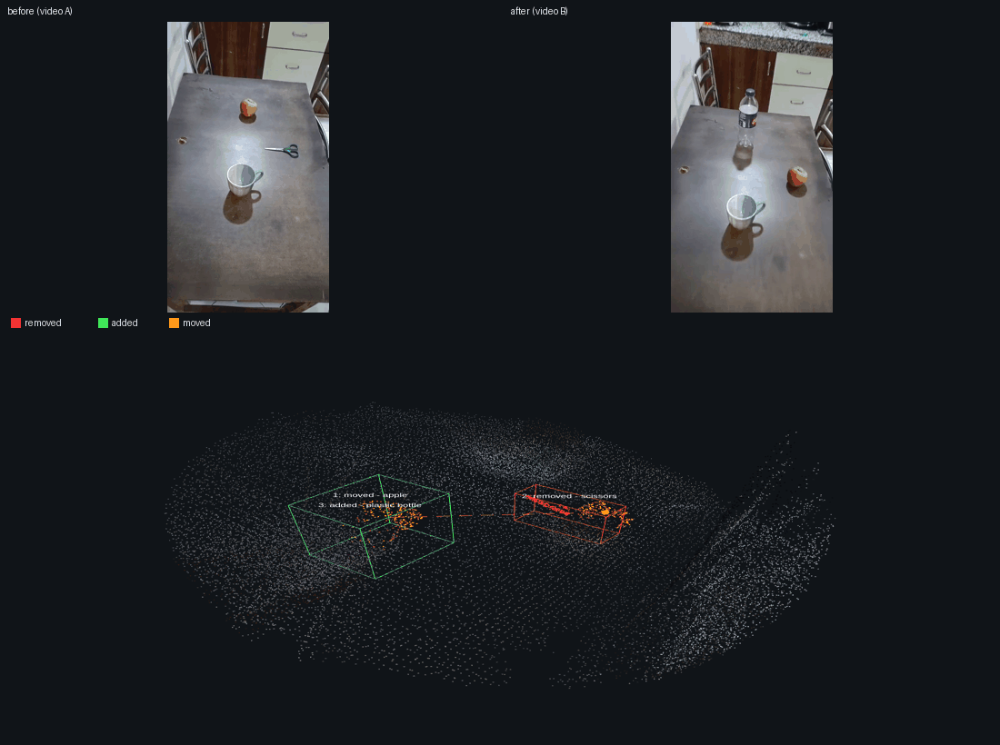
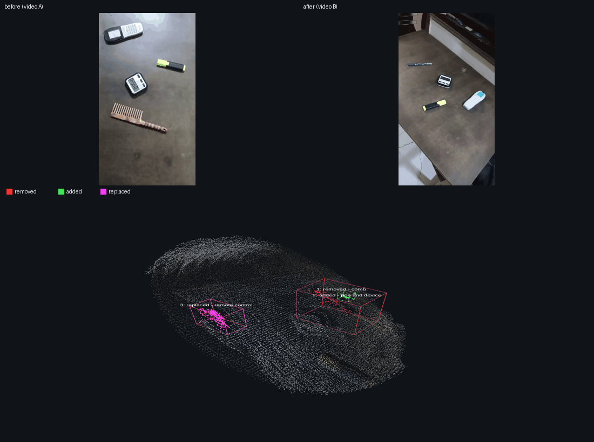
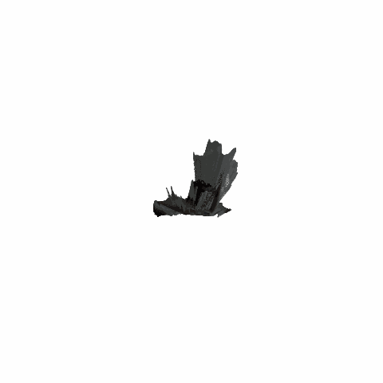
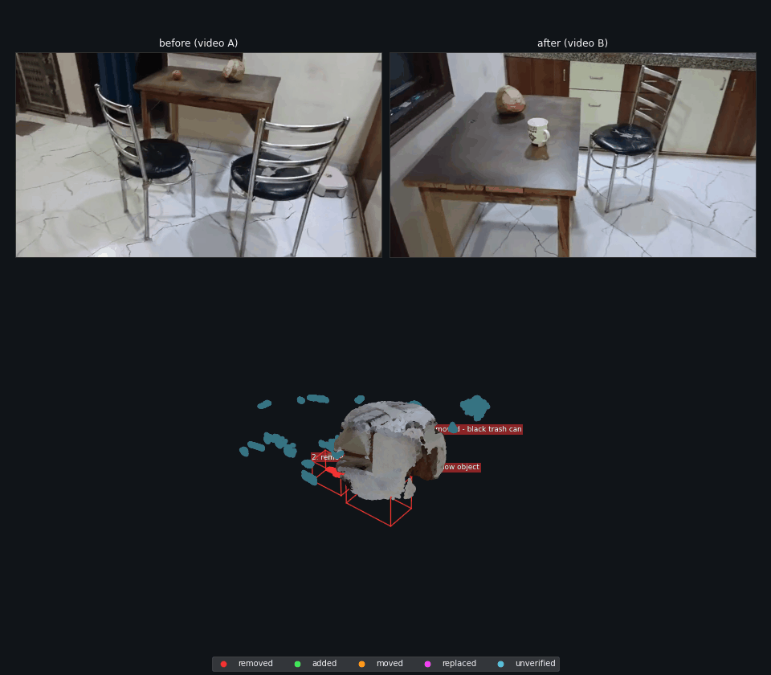

# 3D Scene Change Detection

Give it two phone recordings of the same small indoor space and it builds one
shared 3D reconstruction of the room. It then tells you which objects were
**moved**, **added** or **removed**, each with a semantic label, a natural
language sentence and a 3D location, and shows them in the 3D viewer. One command
runs the whole pipeline; on the cluster it submits and polls its own PBS GPU job.

<!-- DEMO_VIDEO_URL (owner: paste the demo video link here) -->



## Quick start

```bash
git clone https://github.com/Gunjan00001/Humanoid.git && cd Humanoid
conda create -n spatialdiff python=3.10 -y && conda activate spatialdiff
pip install torch torchvision --index-url https://download.pytorch.org/whl/cu126
pip install -r requirements.txt
pip install "vggt @ git+https://github.com/facebookresearch/vggt.git"
# model weights (VGGT, Qwen3-VL-32B, DINOv2): download once, see docs/setup.md
python detect.py --a data/a.mp4 --b data/b.mp4 --name demo
```

`detect.py` validates the two videos and runs the pipeline, writing
`outputs/demo/`: `report.md`, `summary.*`, `change.gif`, `viewer.html`,
`scene_mesh.ply`.

## Challenge requirements and where to find them

| requirement | where it is |
|---|---|
| a shared 3D representation of both recordings | `outputs/scene4/scene.ply` and the TSDF mesh `scene_mesh.ply`; the interactive [`viewer.html`](https://gunjan00001.github.io/Humanoid/outputs/scene4/viewer.html); built in `src/reconstruct.py` |
| moved, added and removed objects, visualized in 3D | [`outputs/scene4/change.gif`](outputs/scene4/change.gif) and one composite per change in `outputs/scene4/changes/` (before, after, 3D box); each change carries a 3D centroid and box in `report.json` |
| changes described with semantic labels and natural language | `summary.txt`, `summary.md` and `report.md` per scene; labels and sentences come from Qwen3-VL and are validated against the report fields |

## Results at a glance

| set | scene | ground truth | detected | mode / notes |
|---|---|---|---|---|
| development (tuned) | demo | comb removed, pen added, remote moved+flipped | **3/3**, 0 extra | `tabletop` |
| development (tuned) | scene2 | coconut removed | **1/1**, 4 extra | `geometric`, per-scene tuning |
| development (tuned) | scene3 | chair removed, apple→cup | **2/2**, 2 extra | `tabletop`, per-scene tuning |
| development (tuned) | scene4 | apple moved, scissor removed, bottle added | **3/3**, 0 extra | `tabletop` |
| **held-out** | scene5 | clock moved, chair removed | **1/2 (type only)**, ≥2 extra | run once, defaults |
| **held-out** | scene6 | cup moved, remote removed, apple added | **1/3** (remote removed), 1 extra | run once, defaults |

The development scenes were used to tune thresholds, so their numbers are fit,
not a benchmark. The held-out scenes (scene5, scene6) were each run **exactly
once** with the frozen code and default settings, pre-registered scoring rule,
per-change tables and failure analyses are in
[`docs/heldout.md`](docs/heldout.md).

**Reproducibility (3x per scene, frozen code, fresh caches):** deterministic in
this set, scene4 **3/3** and scene6 (2 entries) reproduced **identically**
every run; scene5 gave 7 entries each; scene2 runs only at its documented
working point (5 entries each), **at defaults it cannot run** (its shipped
clips are 3.8 s / 7.3 s, too few sharp frames). Full table:
[`docs/results.md`](docs/results.md).

## Known limitations

- mixed orientation / resolution between the two recordings weakens the
  reconstruction and the crops (scene5);
- large objects fragment (scene5's chair); thin objects can be missed;
- a move is only counted when reported as `moved` (scene5's clock and scene6's
  cup were both missed);
- object names come from a VLM and can be wrong;
- the automatic diff-mode choice is sensitive to the exact input encoding.

Built for small tabletop scenes. On the room scale SceneDiff pairs the pipeline
does not carry over: 13 of 20 validation pairs were unprocessable at the frozen
blur setting (fewer than 8 sharp frames) and the 7 that ran produced no object
level matches. The adapter itself is verified by a projection control, so this is
a detection and domain limit, not a plumbing limit. Details and numbers:
[`docs/evaluation.md`](docs/evaluation.md).

Full, honest numbers for every scene: [`docs/results.md`](docs/results.md).

## Examples

**scene4 is the headline.** Development scene (tuned), ground truth is apple
moved, scissors removed, bottle added, and the pipeline reports all three with no
extras.

- inputs: [`data/scene4/a.mp4`](data/scene4/a.mp4) and [`data/scene4/b.mp4`](data/scene4/b.mp4)
- viewer (GitHub Pages, owner must enable): https://gunjan00001.github.io/Humanoid/outputs/scene4/viewer.html
- composites, one per change (before, after, 3D box): [`outputs/scene4/changes/`](outputs/scene4/changes)
- report: [`outputs/scene4/report.md`](outputs/scene4/report.md)
- 3D mesh: `outputs/scene4/scene_mesh.ply`

verbatim summary (real output):

```text
Compared a.mp4 and b.mp4. I found 3 change(s):
1. Moved: apple. The apple moved slightly to the right and upward (direction as seen in the before/after crops).
2. Removed: scissors. The scissors were removed.
3. Added: plastic bottle. The plastic bottle appeared.

Notes: 7 unverified candidate(s) were seen in one video only; they are listed in report.json but not counted as changes. Object names come from a vision-language model and can be wrong. Detection thresholds were tuned on the development scenes (demo, scene2, scene3, scene4). No absolute distances are reported (the reconstruction scale is not metric-validated); directions refer to the before/after videos as stated.
Files: viewer.html, change.gif, report.json
```

**scene6 is held-out** (run once, never tuned). Ground truth is cup moved, remote
removed, apple added. It finds the remote and reports one extra; the move and the
apple are missed. Its recall is lower than the development scenes by design.

- inputs: [`data/scene6/a.mp4`](data/scene6/a.mp4) and [`data/scene6/b.mp4`](data/scene6/b.mp4)
- viewer: https://gunjan00001.github.io/Humanoid/outputs/scene6/viewer.html
- composites: [`outputs/scene6/changes/`](outputs/scene6/changes)

verbatim summary (real output):

```text
Compared a.mp4 and b.mp4. I found 2 change(s):
1. Removed - remote control: The remote control was removed from the table.
2. Added - electrical outlet: Possibly an electrical outlet was added to the wall.

Notes: Object names come from a vision-language model and can be wrong. Detection thresholds were tuned on the development scenes (demo, scene2, scene3, scene4). No absolute distances are reported (the reconstruction scale is not metric-validated); directions refer to the before/after videos as stated.
Files: viewer.html, change.gif, report.json
```

## Design choices and tradeoffs

Both videos are reconstructed together in one pass, so every frame lands in one
coordinate frame and no cross run registration is needed. Detection is geometric
and photometric: 3D distance and table appearance propose candidates; the vision
language model only verifies and names them, it never detects. Two checks keep
real changes apart from viewpoint effects. The visibility check marks a cluster
removed only when the other video actually saw that space empty, and the coverage
check requires an addition to sit where the other video saw empty space. A
replacement at the same spot is separated from "nothing changed" by appearance,
because geometry cannot see it. Summaries are generated only from report fields,
so a sentence never claims something the report does not contain. Object names
come from the model and can be wrong. Moves are the weakest part: only 1 of 4
development moves is reported as `moved`. The longer note, with the rejected
ideas and their numbers, is [`docs/design_note.md`](docs/design_note.md).

## Telling real changes from viewpoint and occlusion

| check | what it decides | where |
|---|---|---|
| visibility (seen empty) | a region is `removed` only if the other video's depth saw that space empty | `src/diff.py` (visibility check) |
| coverage of additions | an `added` region must sit where the other video saw empty space | `src/describe.py` coverage check |
| static object suppression | fragments of objects present in both videos are dropped as lighting or blur | `src/describe.py` post filters |
| appearance and depth | a `replaced` claim needs a strong pixel change; a move needs a similar crop at a different 3D spot | `src/describe.py`, DINOv2 |

One real rejected candidate (scene6, `cache/scene6/semantics/rejected.json`): the
cluster labelled `white cup` was VLM confirmed but then dropped, "inside an object
present in both videos (78% of its points), lighting/blur artefact", so it was not
reported as an addition.

## Hardware and a no-GPU path

GPU memory: the reconstruction (VGGT) fits one 80 GB A100; the label model
(Qwen3-VL-32B, bf16) needs about 64 GB, so two A100s, or one A100 plus CPU offload
which is much slower. Measured runtime on the cluster ([`docs/timing.md`](docs/timing.md)):
a warm run is **2:16 to 3:12 per development scene** (demo 2:27, scene2 2:16,
scene3 2:20, scene4 3:12); the held-out scene5 **cold run was 7:07** on the node
(7:22 total). Queue wait measured 0 s to 1:33. The number of VLM verifications and
the node load change this a lot: the describe stage measured 3:29 to 3:54, and a
busy node that forces the 32B onto CPU offload can push one video pair past ten
minutes. Frame extraction, the diff, the report and the visualization
are CPU only. A smaller label model exists (`Qwen3-VL-8B-Instruct`, one GPU); the
measured difference is documented in [`docs/timing.md`](docs/timing.md).

No GPU needed to see results: open the committed `viewer.html` files, read
`report.md` and `summary.txt` for each scene, or re-render the figures from the
cached stages with

```bash
python src/visualize.py --config configs/default.yaml \
    --cache cache/scene4 --out outputs/scene4 --render-only
```

## More evidence

Benchmarks and sprint logs live in docs: [`docs/results.md`](docs/results.md)
(all scenes), [`docs/heldout.md`](docs/heldout.md) (held-out protocol),
[`docs/accuracy.md`](docs/accuracy.md) (accuracy sprint),
[`docs/negative_results.md`](docs/negative_results.md) (what did not help),
[`docs/evaluation.md`](docs/evaluation.md) (SceneDiff check),
[`docs/timing.md`](docs/timing.md) (measured runtimes).

## Results

On the demo scene (two 8–12 s phone recordings of a table; ground truth: comb
**removed**, pen **added**, AC remote **moved and flipped**), the pipeline
detected and described all three changes with **no false positives** in the
final report:



| # | Ground truth | Detected | Description (Qwen3-VL) | Confidence |
|---|---|---|---|---|
| 1 | comb removed | `removed` | "The comb was removed from the table." | 0.87 |
| 2 | pen added | `added` | "A blue pen and a white device were added to the surface." | 0.38 |
| 3 | remote moved + flipped | `replaced` | "The remote control was replaced with a different one." | 0.84 |

- Visualization: `outputs/change.gif` (rotating colored cloud, red = removed,
  green = added, magenta = replaced) and one framed screenshot per change in
  `outputs/changes/`.
- Reports: `outputs/report.json`, `outputs/report.md`.
- The change detector proposed 26 candidates; 22 were rejected with documented
  reasons (`cache/semantics/rejected.json`), mostly lighting/blur differences
  on static objects. Nothing was silently dropped.

Known limitations of this run (details in [`docs/results.md`](docs/results.md)):
the remote's in-place flip is reported as `replaced` rather than `moved`; the
pen's label includes the neighbouring timer; one-video-only areas can only
produce *unverified* candidates.

### Backend comparison (v0.5)

Two more reconstruction backends were added and compared against VGGT on the
same frames ([full numbers](docs/results.md#backend-comparison-vggt-vs-mapanything-vs-depth-anything-3)):

- **VGGT + `tabletop` remains the best single configuration** (3/3 changes,
  0 false positives).
- **MapAnything** (Apache-2.0) matches it with its threshold calibrated
  (3/3, 0 FP) and brings **metric scale by construction** plus a geometric
  diff that sees the 1 cm-thick comb and pen (VGGT's depth maps cannot).
- **Depth Anything 3** (DA3-LARGE-1.1, Apache-2.0, stretch goal, via
  MapAnything's unified interface) is the **fastest and lightest** backend
  (0.10 s/frame, 6.2 GiB), aligns best, and shows the strongest thin-object
  response; its appearance scores need calibration and it kept one timer false
  positive in tabletop mode.
- Backend choice is `reconstruction.backend: vggt | mapanything` (DA3 via
  `--model-key da3_apache`); the default stays VGGT + `tabletop`.

### Results on the development scenes (v0.10.0)

**These are development scenes, not a held-out test.** The pipeline's defaults
and the per-scene thresholds (scene2, scene3) were tuned on these same
recordings, so the numbers below measure fit on development data. All five
runs use the same pipeline; full details in
[`docs/results.md`](docs/results.md#results-across-all-scenes):

| Scene | Ground truth | Detected | False positives | Mode / tuning |
|---|---|---|---|---|
| **demo** (`data/`) | comb removed, pen added, remote moved+flipped | **3/3** | **0** | `tabletop` (default) |
| **scene2** (`data/scene2/`) | coconut removed | **1/1** (coconut ✓), the committed report; a full v0.12 re-run produces 2 entries (coconut correctly named + the apple false positive), see the reproducibility note | 4 extra entries | `geometric` (big object; lighting-immune) + `--blur_threshold 25` |
| **scene3** (`data/scene3/`) | chair removed, apple→cup | **2/2** objects, types now correct (chair `removed`, apple→cup `replaced`, v0.9.0) | 2 extra entries + unreliable naming (see results.md) | `tabletop` + `--min_change_score 85` |
| **scene4** (`data/scene4/`) | apple moved, scissor removed, bottle added | **3/3** (`moved` apple ✓, `removed` scissors ✓, `added` bottle ✓) | **0 extra entries** | `tabletop` (default) |

**scene2**, coconut removed (`geometric` mode; the visibility check confirmed
it with 5896 points seen empty). The `tabletop` mode misses it because video
B's lighting differs strongly; the geometric mode adds 4 coverage-difference
entries (its known weakness with limited A coverage).



**scene3**, both changes found: the chair is now correctly typed `removed`
(empty-space evidence 22%) and the apple→cup region `replaced` (occupied 2%);
2 extra entries and an unreliable replacement sentence remain (video B's crop
of the table is partly occluded by the remaining chair), see
[the correctness pass](docs/results.md#presentation--correctness-pass-v090).



**scene4**, all three ground-truth changes, no tuning and no extras: the
apple is reported as **`moved`** (from → to shown in the report and drawn as a
dashed line in the 3D view), the scissors as **`removed`**, and the bottle as
**`added`** at the apple's old spot. This scene drove the v0.10.0 semantics
work: move matching now runs before the structural filters, objects arriving
at a moved object's origin are reported, and "replaced" claims whose two sides
are independently confirmed changes are dropped as composites, see
[scene4 in results](docs/results.md#scene4).


Honest summary, **on these development scenes**: 9/9 ground-truth changes
found overall (demo 3/3, scene2 1/1, scene3 2/2, scene4 3/3). The demo and
scene4 reach their totals with 0 extra entries using the default mode; scene2
and scene3 each needed a short per-scene tuning pass and both carry documented
extra entries. That is the expected behaviour of a scene-tuned photometric
pipeline, and because the thresholds were tuned on these same recordings, the
9/9 should not be read as a held-out benchmark result.

**Faithful 3D rendering (v0.8.0)**, each scene now ships a dark-background
render with per-change bounding boxes + labels and a before | after | 3D
layout, a colored **TSDF mesh** (`scene_mesh.ply`, ≤ 10 MB) and a
**self-contained interactive viewer** (`viewer.html`, open it in any browser:
orbit, zoom, toggle video A / B / changes / unverified / full scene).
Diagnosis and the `input_mode=pad` experiment:
[visualization rework](docs/results.md#visualization-rework-steps-05).

### Held-out result (scene5, v0.12)

Scene5 (`data/scene5/`: clock moved, chair removed; never used for tuning) was
run **exactly once** with the frozen code and default settings
(`python detect.py --a data/scene5/a.mp4 --b data/scene5/b.mp4 --name scene5`).
Honest result, confirmed by overlay review:

| GT change | detected | correct? | confidence |
|---|---|---|---|
| clock **moved** |, (no `moved` entry) | **missed** |, |
| chair **removed** | `removed`, 3 fragments (labels "wooden leg" / "chair leg" / "table leg") | **type only**; labels wrong | 0.74 / 0.29 / 0.45 |

**Scoring (pre-registered rule): found 1/2 (type only) · labels 0/2 · missed
1 · extras ≥ 2.** The runner flagged a mixed-orientation recording (A
landscape 860x480, B portrait 480x860) and the auto mode chose `geometric`
(dominant plane 11% of confident points); both are *likely* contributors (not
proven). The verbatim summary, runtimes, the failure analysis, a post-hoc
tabletop diagnostic and the checking sheet are in
[`docs/heldout.md`](docs/heldout.md).

### Known limitations

- **mixed orientation / resolution between the two recordings**, detect.py
  warns loudly and recommends recording both videos in the same orientation
  (landscape preferred); scene5's A/B mismatch likely weakened the
  reconstruction and the crops;
- **floor reflections and lighting** produce candidate fragments, scene5's
  "small round object" was a floor reflection in video B;
- **large objects fragment**, scene5's chair removal was reported as three
  separate "leg" entries instead of one chair;
- **object names are unreliable** (VLM-generated): scene5's chair fragments,
  scene3's "black trash can" for the chair, scene4's scissor sentence before
  the summary-stage fix.

**Runtime (measured, not estimated)**, full numbers and clock bases in
[`docs/timing.md`](docs/timing.md):

| Case | Wall clock | Conditions |
|---|---|---|
| One new scene, full pipeline + 3D map | **5–6 min on the node** | 2 A100s, model files warm, 3 concurrent 1-GPU jobs from the same account running; excludes queue wait |
| Queue wait | 0–1:33 in the measured runs | caused by the queue's **per-user 16-CPU quota**, not by GPUs; 0 s once a slot was free |
| Semantics re-run (`describe` + `report`), VLM cache warm | **0:33–2:12** | no model load; fresh VLM calls add ~11 s each |
| Re-render only (composites + Chrome GIF + mesh, no GPU) | **2:09–5:46 per scene** (measured: demo 3:11, scene2 3:24, scene2-geo 2:09, scene3 5:46, scene4 3:21) | login node, Chrome available; scene3's time is dominated by its 31 change candidates (27 unverified composites) and a denser cloud in the Chrome GIF |
| Model loads | VGGT 8–14 s · Qwen3-VL-32B 26 s (warm) to 2:07 (cold) | measured across runs |

Re-render only, without touching any pipeline stage:

```bash
python src/visualize.py --config configs/default.yaml \
    --cache cache/scene4 --out outputs/scene4 --render-only
```

It reuses the cached reconstruction/diff/VLM outputs, needs no GPU, and stops
with a list of missing files if anything required is absent, it never
recomputes a stage.

An earlier claim of "~15 min per scene" was not reproducible from the logs and
has been corrected in [`docs/results.md`](docs/results.md#timings-wall-clock-this-run).

**Live interactive viewers** (GitHub Pages, live; see
[`docs/hosting.md`](docs/hosting.md)):
[demo](https://gunjan00001.github.io/Humanoid/outputs/viewer.html) ·
[scene2](https://gunjan00001.github.io/Humanoid/outputs/scene2/viewer.html) ·
[scene2 geometric](https://gunjan00001.github.io/Humanoid/outputs/scene2_geo/viewer.html) ·
[scene3](https://gunjan00001.github.io/Humanoid/outputs/scene3/viewer.html) ·
[scene4](https://gunjan00001.github.io/Humanoid/outputs/scene4/viewer.html) ·
[scene5 (held-out)](https://gunjan00001.github.io/Humanoid/outputs/scene5/viewer.html) ·
[scene6 (held-out)](https://gunjan00001.github.io/Humanoid/outputs/scene6/viewer.html)

## Pipeline

```
Video A ─┐                                         ┌─> colored 3D PLY
         ├─> frames ─> VGGT (joint) ─> point cloud ┤
Video B ─┘            shared frame       A / B tags └─> diff + visibility check
                                                         │
                                         clusters ─> crops ─> Qwen3-VL ─> labels + sentences
                                                         │
                                         DINOv2 matching ─> moved / added / removed
                                                         │
                                                         └─> JSON + Markdown report
```

Stage-by-stage detail: [`docs/pipeline.md`](docs/pipeline.md).

## Models

| Role | Primary | Fallback |
|---|---|---|
| 3D reconstruction (poses, depth, point cloud) | VGGT | MapAnything → MASt3R → COLMAP/hloc |
| Labels and descriptions | Qwen3-VL-32B-Instruct | Qwen3-VL-8B, Gemma (vision) |
| Cross-scene object matching ("moved") | DINOv2 | SigLIP 2 |
| Object masks (stretch goal) | SAM 2 | DBSCAN clusters only |

Two reconstruction backends are implemented and write the same artifact
contract, so the rest of the pipeline is backend-agnostic
(`reconstruction.backend: vggt | mapanything`). The measured comparison
(alignment, metric scale, thin-object visibility, end-to-end results) is in
[`docs/results.md`](docs/results.md#backend-comparison-vggt-vs-mapanything).

Model licenses, **verified 2026-10-10**: Qwen3-VL, DINOv2, SigLIP 2, SAM 2 and
the MapAnything checkpoint we use are Apache-2.0; **VGGT is CC-BY-NC-4.0
(non-commercial)**; MASt3R's repo is gated.
See [`docs/models.md`](docs/models.md) for IDs, commits, and the checklist.

## Setup

- **GPU cluster (PBS):** [`docs/setup.md`](docs/setup.md) and [`gpu.md`](gpu.md)
- **Laptop (CPU-only stages):** [`docs/setup.md`](docs/setup.md)

Cluster essentials: PyTorch wheels for **CUDA 12.6 (`cu126`)**, and
**`unset CUDA_VISIBLE_DEVICES`** before any CUDA work (PBS sets it empty, which
hides all GPUs). Per-job limits: 16 CPUs, 64 GB RAM, 24 h, 5 jobs.

## How to run

```bash
python run.py --video_a data/a.mp4 --video_b data/b.mp4 --out outputs/
```

`detect.py` is the one-command runner (validation, automatic diff-mode
choice, GPU/PBS handling, natural-language summary); `run.py` remains the
low-level orchestrator. Every stage also runs alone and reads/writes only the
cache:

```bash
python src/extract_frames.py --config configs/default.yaml
python src/reconstruct.py    --config configs/default.yaml   # GPU
python src/diff.py           --config configs/default.yaml
python src/describe.py       --config configs/default.yaml   # GPU
python src/visualize.py      --config configs/default.yaml
python src/report.py         --config configs/default.yaml
```

Status: end-to-end on five recordings; the demo, scene3 and scene4 reports
reproduce identically under a full `detect.py --force` re-run, scene2 does not
(see [`docs/heldout.md`](docs/heldout.md) for the held-out protocol and
[`docs/devlog.md`](docs/devlog.md) for the reproducibility note). Cluster
templates live in `scripts/`.

## Design decisions

1. **Joint reconstruction**, both videos are reconstructed in a single VGGT
   run so every frame lands in one coordinate frame, avoiding fragile
   cross-run registration.
2. **Occlusion-aware diff**, a region counts as *removed* only if the other
   video actually observed that space and saw it empty (visibility check using
   cached poses and depth). This suppresses false positives from occlusion.
3. **DINOv2 move matching**, a removal and an addition with similar crop
   embeddings but different 3D positions are reported as one *moved* object
   instead of two separate changes.

## Limitations and failure cases

Observed on the demo scene (quantified in [`docs/results.md`](docs/results.md)):

- objects thinner than VGGT's patch scale (~1.4 cm here) are **absent from the
  depth maps**, geometric diffing cannot see them; the photometric tabletop
  mode is required;
- static objects whose appearance differs between recordings (blur, exposure,
  viewing angle) generate candidate fragments that the VLM and structural
  filters must reject;
- a replacement at the same spot (comb → pen) is geometrically
  indistinguishable from "nothing changed"; appearance comparison is what
  separates them;
- areas one video never observed (portrait crop, occlusion) can only yield
  *unverified* candidates, reported separately and never counted as changes;
- reflective surfaces, textureless walls and scale ambiguity remain expected
  failure modes on other scenes (not all reproduced here).

## Documentation

| File | Contents |
|---|---|
| [`docs/handoff.md`](docs/handoff.md) | **Next-agent brief: state, next steps, environment, pitfalls** |
| [`docs/heldout.md`](docs/heldout.md) | Held-out protocol + scene5's honest result and post-hoc runs |
| [`AGENT_PLAN.md`](AGENT_PLAN.md) | Plan, phases, checkpoints (source of truth) |
| [`docs/pipeline.md`](docs/pipeline.md) | Stage-by-stage pipeline and inputs/outputs |
| [`docs/verification.md`](docs/verification.md) | Every verification rule with the demo's real numbers |
| [`docs/debugging.md`](docs/debugging.md) | Cache map, inspector tool, per-symptom playbooks |
| [`docs/setup.md`](docs/setup.md) | Environment setup and run instructions |
| [`docs/models.md`](docs/models.md) | Model stack, VRAM plan, license checklist |
| [`docs/data.md`](docs/data.md) | Recording guide and ground-truth template |
| [`docs/architecture.md`](docs/architecture.md) | Repo layout, modules, config reference |
| [`docs/results.md`](docs/results.md) | Real results of the first end-to-end run |
| [`docs/troubleshooting.md`](docs/troubleshooting.md) | Cluster and model failure modes |
| [`docs/roadmap.md`](docs/roadmap.md) | Phase status checklist + per-version history |
| [`docs/timing.md`](docs/timing.md) | Measured runtimes (queue vs job, cold vs warm) |
| [`docs/hosting.md`](docs/hosting.md) | GitHub Pages for the interactive viewers |
| [`gpu.md`](gpu.md) | Cluster / GPU access reference |
| [`rules.md`](rules.md) | Working rules for agents |

## License

MIT, see [`LICENSE`](LICENSE). Model checkpoints keep their own licenses.

## Licenses and citations

| component | license | used for |
|---|---|---|
| VGGT (`facebook/VGGT-1B`) | **CC BY-NC 4.0**, non commercial | 3D reconstruction |
| Qwen3-VL-32B-Instruct | Apache-2.0 | verification, labels, sentences |
| DINOv2 (`facebook/dinov2-large`) | Apache-2.0 | cross crop matching |
| SAM 2 (`facebookresearch/sam2`) | Apache-2.0 | accuracy sprint probe only, not in the pipeline |
| MapAnything (`facebook/map-anything-apache`) | Apache-2.0 | alternative reconstruction backend |
| Depth Anything 3 (`depth-anything/DA3-LARGE-1.1`) | Apache-2.0 | stretch backend |
| SceneDiff dataset and code | MIT | external evaluation |
| HD-Epic | its own terms | source of the SceneDiff kitchen subset, not used here |
| PyTorch, OpenCV, Open3D, NumPy, SciPy, scikit-learn, matplotlib | BSD or Apache style | base stack |

The repository itself is MIT (see `LICENSE`). Model checkpoints keep their own
licenses; VGGT is the only non-commercial one in the default path.

Citations: VGGT (`facebookresearch/vggt`, `facebook/VGGT-1B`); Qwen3-VL
(`Qwen/Qwen3-VL-32B-Instruct`); DINOv2 (`facebook/dinov2-large`); SceneDiff
(Wu et al., `yuqunw/scene_diff`, https://arxiv.org/abs/2512.16908); HD-Epic
(https://hd-epic.github.io/).
